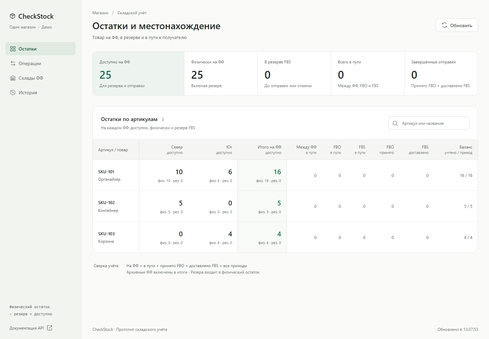

# CheckStock

Веб-прототип: показывает, где находится товар — на фулфилменте,
в резерве FBS, между ФФ, на пути в FBO или к клиенту FBS.

Python 3.12 · FastAPI · PostgreSQL · SQLAlchemy 2 · Alembic · Jinja2 · JavaScript.
Swagger UI на `/docs` использует стандартные внешние ресурсы FastAPI.



## Запуск на Windows / PowerShell

Требуются **Python 3.12** и установленный **PostgreSQL 16+ с серверными утилитами**.
Проверено с PostgreSQL 18. Все команды выполняются из корня репозитория.

```powershell
python -m venv .venv
.\.venv\Scripts\python.exe -m pip install -r requirements.lock.txt
.\.venv\Scripts\python.exe scripts/setup_local.py
.\.venv\Scripts\python.exe -m alembic upgrade head
.\.venv\Scripts\python.exe -m app.seed
.\.venv\Scripts\python.exe -m uvicorn app.main:app --host 127.0.0.1 --port 8000
```

Открыть **http://127.0.0.1:8000**. API: **http://127.0.0.1:8000/docs**.
Проверка подключения: **http://127.0.0.1:8000/health**.

`setup_local.py` находит `C:\Program Files\PostgreSQL\*\bin`, создаёт отдельный
кластер в `.local/postgres`, запускает его только на `127.0.0.1:55432` и создаёт
базы `checkstock` и `checkstock_test`. Случайный пароль записывается в `.env`.

Если утилиты находятся в другом месте, перед запуском указать:

```powershell
$env:PG_BIN = 'C:\Program Files\PostgreSQL\18\bin'
```

Если порт занят, **до первого создания кластера** выбрать другой:

```powershell
$env:CHECKSTOCK_PG_PORT = '55433'
```

Остановить веб-сервер: `Ctrl+C`. Остановить PostgreSQL этого проекта:

```powershell
.\.venv\Scripts\python.exe scripts/setup_local.py --stop
```

Для следующего запуска повторить `setup_local.py` и команду `uvicorn`.
Данные сохраняются. Миграции и загрузку примеров можно повторять безопасно:
`seed` не сбрасывает остатки, не дублирует приходы и не отменяет ручные изменения.

## Тестовые данные

Команда `python -m app.seed` создаёт один подразумеваемый магазин, два ФФ и приходы:

| Артикул | Товар | Север | Юг |
|---|---|---:|---:|
| SKU-101 | Органайзер | 10 | 6 |
| SKU-102 | Контейнер | 5 | 0 |
| SKU-103 | Корзина | 0 | 4 |

Всего 25 единиц. Нулевые остатки также отображаются. Начальные количества
попадают в историю обычными приходами, поэтому их можно сверить с журналом.

## Как пользоваться

- **Остатки:** поиск товара, доступное/физическое/резерв по каждому ФФ,
  отдельные показатели трёх видов товара в пути и завершённых отправок.
- **Операции:** приход, отправка перемещения между ФФ, резерв FBS и отправка FBO.
  Последующие действия доступны в строке операции: отправить, отменить резерв,
  принять или подтвердить доставку.
- **Склады ФФ:** добавить, переименовать, удалить в архив.
- **История:** действия, маршруты, количества и изменения остатков; фильтры по товару и ФФ.

Если на выбранном складе не хватает товара, операция отклоняется целиком.
Сообщение показывает требуемое количество и доступные остатки других ФФ.
Нужно отправить перемещение с другого ФФ, принять его и повторить действие.


### Почему удаление — архивирование

Физическое удаление склада потеряло бы место хранения товара и ссылки истории.
Поэтому `DELETE /api/warehouses/{id}` переводит ФФ в архив. Остатки остаются за ним,
видны отдельной колонкой и включаются в итоги.

Новые приходы, резервы и перемещения **в архивный ФФ** запрещены. Разрешены:

- Перемещение свободного остатка из архива в активный ФФ или отправка FBO.
- Отправка/отмена FBS-резервов, созданных до архивации.
- Приёмка перемещения, отправленного до архивации склада назначения.

Так не теряется товар и не зависают начатые операции. Архивация повторяема.
Названия источника и назначения сохраняются в событии на момент действия:
переименование склада не переписывает прошлую историю.

### API и структура

`app/services.py` содержит правила и все изменения учёта; `app/queries.py` —
представления остатков и истории; HTTP-обработчики управляют границами транзакций.
HTML и JSON используют одну серверную логику. Alembic создаёт структуру БД,
приложение не вызывает `create_all` при запуске.

| API | Назначение |
|---|---|
| `GET /api/dashboard`, `/api/stock` | Согласованный снимок остатков |
| `GET /api/products`, `/api/warehouses` | Справочники |
| `POST /api/warehouses` | Новый ФФ |
| `PATCH /api/warehouses/{id}` | Переименование |
| `DELETE /api/warehouses/{id}` | Архивирование |
| `GET`, `POST /api/operations` | Список и создание операции |
| `POST /api/operations/{id}/{action}` | `ship`, `cancel`, `receive`, `deliver` |
| `GET /api/history?product_id=1&warehouse_id=2` | История с необязательными фильтрами |

422 — ошибка входных данных; 404 — объект не найден; 409 — нехватка или конфликт
состояния. Swagger `/docs` показывает схемы входных данных.

## Проверки

```powershell
.\.venv\scripts\python.exe -m pytest -q
.\.venv\scripts\python.exe -m ruff check .
.\.venv\scripts\python.exe -m alembic check
```

**36 тестов** проходят на реальном PostgreSQL, включая:

- Приход, резерв, отмену, отправки и приёмки; нулевые остатки.
- Нехватку на выбранном ФФ при достаточном общем количестве и запрет использования резерва.
- Архив с остатками, существующими резервами и входящим перемещением.
- Повторные/конкурентные создания и подтверждения; соревнование отправки и отмены.
- Два конкурентных резерва и создание первого остатка двумя запросами.
- Полный откат после имитации ошибки записи истории.
- Восстановление остатков суммированием изменений из журнала и баланс товара.
- Повторяемость seed после ручных изменений, валидацию и неизменность названий истории.

**Внимание к тестовой базе:** тесты очищают данные только в `TEST_DATABASE_URL`.
Имя базы обязано оканчиваться на `_test`; совпадение с базой приложения запрещено.
Используйте исключительно отдельную базу для тестов.

Для проверки браузером дополнительно:

```powershell
.\.venv\Scripts\python.exe -m pip install -r requirements-browser.txt
.\.venv\Scripts\python.exe tests/browser_check.py
```

## Использование ИИ

ИИ использован при подготовке структуры, кода, интерфейса, тестов и документации.
Результат проверен складскими сценариями, конкурентными запросами, сверкой журнала
и сквозным сценарием в браузере на PostgreSQL.
